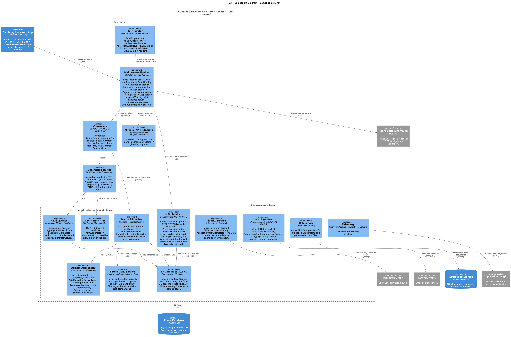

# Component Diagram (C3) – Gambling Levy Portal API

**Document Version:** 1.5 | **Date:** October 2026

> This document extends [Technical-Architecture-Spec.md](Technical-Architecture-Spec.md)'s C1 (System Context) and C2 (Container) diagrams one level further, per the C4 model: it zooms into the **Gambling Levy API** container and shows the internal components that make it up, and how they depend on each other and on external systems. It does not repeat the Client or Database internals — those stay at the container level.

This diagram is grounded directly in the current `api/src` codebase. Where its content differs from what's written elsewhere in `design_docs/`, the difference is called out explicitly in §3 below rather than silently repeated.

---

## 1. Diagram

*Source: [docs/C4_Component.puml](docs/C4_Component.puml) · Rendered: [docs/C4_Component.png](docs/C4_Component.png)*

{width=100%}

---

## 2. Components

The API follows Clean Architecture (`Api → Application → Domain ← Infrastructure`). Components are grouped below by that dependency flow, matching the three boundaries drawn in the diagram.

### 2.1 Api layer

| Component | Location | Responsibility |
|---|---|---|
| **Middleware Pipeline** | `Api/Program.cs` | Load-bearing order: CORS → Routing → Rate Limiting → Validation Exception Handler → Authentication → Authorization → Organisation Suspended → MFA Required → Application Insights Tracing. MFA Required refuses every non-exempt request that has no valid MFA session (only `/mfa/*`, `/swagger` and `/health` are exempt). |
| **Rate Limiter** | `Api/Middleware` | Hand-written per-IP/per-route fixed-window limiter. Built by hand because `Microsoft.AspNetCore.RateLimiting` has no success-path hook, and `RateLimit-*` headers must appear on successful responses too, not just 429s. |
| **Controllers** | `Api/Controllers` (16) | Route HTTP requests. Writes call `ISender.Send(command)`; 9 of 16 controllers also inject a Controller Service for reads, 4 are read-only via a Controller Service alone, and 3 use neither pattern. |
| **Minimal API Endpoints** | `Api/Modules/ApiEndpointsModule.cs` | A second routing surface alongside `MapControllers()`: `/`, `/health`, `/uptime`. |
| **Controller Services** | `Api/Services/Implementation` | Assembles read-side DTOs from Read Queries; also owns CSV/ZIP export composition (`ReportSnapshotService`, the DHSC cross-org export, the LA per-organisation export). |

### 2.2 Application + Domain layers

| Component | Location | Responsibility |
|---|---|---|
| **MediatR Pipeline** | `Application/{Aggregate}/Commands/*` | ~70 command/handler slices, one file per action. `ValidationBehaviour` + `UnhandledExceptionBehaviour` pipeline behaviours run on every command. Reads bypass MediatR almost entirely and go through the next component instead. |
| **Read Queries** | `Application/Common/Interfaces/Queries/I{Aggregate}Queries.cs` | One read interface per aggregate. Reads deliberately bypass MediatR; the interface is implemented directly in Infrastructure (usually by the same class as the write-side repository). |
| **Domain Aggregates** | `Domain/*` | Activities, AuditLogs, Categories, Collections, DataCollectionForms, Forms, Funding, KeyResults, Locations, LocationUsers, Organisations, OrganisationUsers, Submissions, Users. Entities have private constructors and static `New(...)` factories; IDs are strongly-typed records. |
| **Permissions Service** | `Application/Common/Permissions` | Resolves the caller's identity and organisation scope for authorisation and query filtering. Org-scoped handlers resolve the caller's org from here, never from an id in the request body. |
| **CSV / ZIP Writer** | `Application/Common/Csv` | RFC-4180 CSV, UTF-8 without BOM, with spreadsheet formula-injection neutralisation on every cell. Shared by every export in the app — never a hand-rolled string join. |

### 2.3 Infrastructure layer

| Component | Location | Responsibility |
|---|---|---|
| **EF Core Repositories** | `Infrastructure/Persistence` | Implements Read Queries and `I*Repository` interfaces via `RepositoryBase<T,TKey>`. PostgreSQL via `EFCore.NamingConventions` (snake_case). |
| **Identity Service** | `Infrastructure/Identity` | Microsoft Graph-backed CIAM user provisioning. `ApplicationUserClaimsTransformation` synthesises the role/organisation claims on every request from the database, not from the token. |
| **MFA Services** | `Infrastructure/Mfa` | Application-managed TOTP MFA (RFC 6238, `Otp.NET`), the implementation deployed in production; Entra Conditional Access is not used. `TotpService` generates and checks codes; `MfaEncryptionService` encrypts TOTP secrets with ASP.NET Core Data Protection; `RecoveryCodeService` issues single-use, BCrypt-hashed recovery codes; `MfaSessionService` issues and validates the MFA session cookie (30-minute idle timeout, 8-hour cap, User-Agent bound); `MfaRateLimitService` limits attempts, alongside a 5-failure / 30-minute lockout. `MfaSessionRetentionHostedService` sweeps expired session rows. |
| **Email Service** | `Infrastructure/Email` | GOV.UK Notify-backed: `InvitationEmailService`, `SubmissionConfirmationEmailService`. A logging/no-op variant swaps in for non-production so no real email leaves lower environments. |
| **Blob Service** | `Infrastructure/Blob` | Azure Blob Storage client for uploaded attachments and generated export files. |
| **Telemetry** | `Infrastructure` / `Api` startup | `Microsoft.ApplicationInsights.AspNetCore` — the sole monitoring provider. |

---

## 3. Corrections relative to the existing docs

This diagram intentionally departs from a few claims made elsewhere in `design_docs/`:

- **Application Insights is the sole monitoring provider.**
- **No Background Worker exists inside this container** (and none exists at all in this repo). `Technical-Architecture-Spec.md` §3.3 already flags this as "unverified against this repo" — this component diagram confirms it by omission: everything shown here runs in-process inside the API, including the one real `IHostedService` (`MfaSessionRetentionHostedService`), which isn't a general-purpose job worker and isn't pictured separately.
- **Domain model is the current 14-aggregate, 3-role model**, not the `UserOrgMembership` / `MaturityRecord` / `CollectionOrg` / `SpendReport` model still described in §5/§6/§8 of the architecture spec (already flagged there as stale in its own changelog). This diagram's Domain Aggregates component lists the real aggregate names.
- **Hosting is Azure App Service (zip deploy), not Docker** — matching the correction already applied to §1.3/§4.1 of the architecture spec, but not yet applied to `docs/C4_Container.puml`, which still labels the Web App and API containers "(Docker)".

None of the above are fixed in `C4_Container.puml`/`C4_Context.puml` as part of this change. Reconciling the C1/C2 sources is the same "dedicated follow-up" the architecture spec's changelog already calls for on §5/§6/§8.

---

## Changelog

| Date | Version | Changes |
|---|---|---|
| 2026-10-29 | 1.5 | **Corrected MFA to match production.** v1.2–v1.4 removed the MFA Services component and described Microsoft Entra-native MFA through Conditional Access as implemented; it is not. Production enforces the application-managed TOTP layer in `Infrastructure/Mfa`, gated by `MfaRequiredMiddleware`. Restored the MFA Services component, the MFA Required step in the middleware pipeline, and the Identity Service description; removed the MFA bullet from §3, since [MFA-Azure-AD-Limitations.md](MFA-Azure-AD-Limitations.md) and [MFA-Implementation.md](MFA-Implementation.md) are accurate. Matches `Technical-Architecture-Spec.md` v2.10. Monitoring wording unchanged. Fixed the header version, which had stayed at 1.0. |
| 2026-08-10 | 1.4 | Per team confirmation, Microsoft Entra-native MFA and Application Insights-only monitoring are implemented, not merely a target — removed the "target production direction, not what's implemented today" framing from the intro and §3 (formerly §3.1/§3.2). §3 is back to being a single "Corrections" list; MFA and monitoring are now stated as fact there alongside the other three corrections, not hedged. |
| 2026-08-10 | 1.3 | Documentation-only clarification to §3.1 (per team confirmation, no source code touched): the MFA note now specifies that users are provisioned as **local Entra accounts** via Microsoft Graph, not federated/guest identities — a different setup than the one MFA-Azure-AD-Limitations.md's custom-TOTP rationale addresses, so that documented blocker may not apply here. Matches `Technical-Architecture-Spec.md` v2.8. |
| 2026-08-10 | 1.2 | Per direction: this diagram now describes the intended **production** architecture for two components, restructuring §3 into a "target production direction" section plus the existing factual "corrections" one. Removed the MFA Services component (custom TOTP, `Infrastructure/Mfa`) — MFA is now Microsoft Entra-native (Microsoft Authenticator via Conditional Access), enforced before a token ever reaches the API, so there is no in-platform MFA component to picture. Telemetry now shows Application Insights only, dropping Sentry. Middleware Pipeline's step order updated to match (no "MFA Required" step; "Sentry Tracing" → "Application Insights Tracing"). `api/src` today still has both the custom MFA layer and Sentry — see §3.1. |
| 2026-08-10 | 1.1 | Email Service component and diagram now name GOV.UK Notify as the notification/email provider, consistent with `Technical-Architecture-Spec.md` (v2.6) — removed the §3 bullet flagging Notify as aspirational. `Infrastructure/Email/SendGridEmailServiceBase.cs` remains the only email integration actually implemented in `api/src` today; this document now describes the intended provider, the same way §2.1's other components describe the current code. |
| 2026-08-10 | 1.0 | Initial C3 component diagram for the API container, built directly from `api/src` rather than from the (partially stale) narrative spec. |
